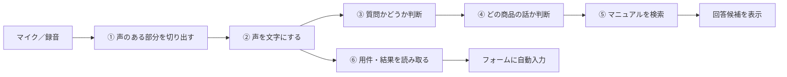

# コールセンター リアルタイム業務支援デモ　システム解説

このドキュメントは、画像・音声認識の知識がない人にも分かるように、このデモが**何をするのか**、**どう動くのか**、**授業のどこを使っているのか**を説明するものです。

---

## 1. ひとことで言うと

**電話の会話を聞き取って、オペレーター（電話を受ける人）の作業を横で手伝うシステム**です。

お客様が話した内容をその場で文字にし、次の2つを自動で行います。

1. **回答候補の表示**：お客様が商品について質問したら、マニュアルから答えを探して画面に出す
2. **入力フォームへの自動入力**：「用件」「対象商品」「結果」を会話から読み取り、記録用のフォームに書き込む

商品・FAQ・マニュアルのページ番号は、すべて架空のデータです。

---

## 2. なぜ作ったのか（背景）

テレビショッピングのコールセンターで、オペレーターは次のことに困っています。

| 困っていること | 具体的には |
|---|---|
| 答えを探すのに時間がかかる | 複数の商品を担当しているため、紙やPDFのマニュアルを探す間、お客様を20〜30秒待たせてしまう |
| 入力作業が多い | 会話をしながら、用件と結果をパソコンのフォームに入力しなければならない |

このシステムは、「**答えを探す時間**」と「**入力の手間**」を減らすことを目指しています。目標は、**質問から10秒以内に回答候補を出すこと**です。

---

## 3. 画面の見方

画面は3つの欄に分かれています。

```text
┌───────────────────┬──────────────────────────────┐
│ ① 自動文字起こし   │ ② 回答候補（確認してから回答） │
│                   │   表示まで 4.1秒（目標10秒）    │
│ お客様：賞味期限は │   冷凍のままで製造日から90日… │
│ いつまでですか？   │   出典：商品マニュアル p.12    │
│                   ├──────────────────────────────┤
│                   │ ③ 入力フォームへ自動入力       │
│                   │   用件　　：商品の問い合わせ   │
│                   │   対象商品：瀬戸内海鮮セット   │
│                   │   結果　　：対応中             │
└───────────────────┴──────────────────────────────┘
```

| 欄 | 何が表示されるか |
|---|---|
| ① 自動文字起こし | 話した内容が文字で表示される。質問と判断した文には赤い下線が付く |
| ② 回答候補 | マニュアルから見つけた答えと、その出典（何ページか）。自信がないときは「候補なし」 |
| ③ 入力フォーム | 会話から読み取った用件・対象商品・結果。最後に人が確認して登録する |

**大事な考え方**：システムは「提案するだけ」です。お客様に答えるのも、記録を登録するのも、最後は必ず人が確認してから行います。音声認識は間違えることがあるためです。

---

## 4. 全体の仕組み

声が入ってから画面に出るまで、次の順番で処理しています。



それぞれを順に説明します。

### ① 声のある部分を切り出す（音声区間検出）

マイクには、話していない時間の「無音」や「雑音」も入ってきます。そこで、**人が話している部分だけを切り出します**。

- 音を25ミリ秒ずつの短い区切り（フレーム）に分けます
- 区切りごとに「音の大きさ（音声パワー）」と「波の細かさ（ゼロ交差率）」を計算します
- 最初の1秒で周りの雑音の大きさを測り、それより十分大きい音を「声」とみなします
- 0.6秒ほど無音が続いたら「話し終わった」と判断します

> たとえるなら、録音テープから「しゃべっているところ」だけをハサミで切り取る作業です。

### ② 声を文字にする（音声認識）

切り出した声を、**Whisper（ウィスパー）**という音声認識の仕組みで文字にします。Whisperは、声を「人間の耳の聞こえ方に合わせた特徴（メル尺度）」に変換し、深層学習（AI）で文字に変えます。

処理はすべてパソコンの中で行い、声をインターネットに送りません。

**工夫：2回聞き取る方式**

商品名（例：讃岐うどんセット）は聞き間違えやすいため、次の2段階で聞き取ります。

1. まずヒントなしで聞き取り、「どの商品の話か」だけを判断する
2. その商品名だけをヒントにして、もう一度聞き取る

最初から全商品の名前をヒントにすると、「讃岐うどん」が「瀬戸内海鮮」のように**別の商品名に引き寄せられる**ことが実験で分かったため、この方式にしました。

### ③ 質問かどうか判断する

「〜ですか」「いつ」「いくら」などの言葉が入っているかで、質問かどうかを判断します。

### ④ どの商品の話か判断する（ワード・スポッティング）

文字にした文の中から、**商品名などのキーワードを探します**。このとき、**多少の聞き間違いがあっても見つけられる**ようにしています。

| 聞き取った文字 | 判断した商品 |
|---|---|
| サヌキヨドンセット | 讃岐うどんセット |
| さぬきうろんセット | 讃岐うどんセット |

文全体を完璧に理解しなくても、キーワードさえ見つかれば答えを探せる、という考え方です。

> たとえるなら、騒がしい場所で会話の全部は聞き取れなくても、「うどん」という単語だけ聞こえれば話題が分かるのと同じです。

### ⑤ マニュアルを検索する

判断した商品のFAQ（よくある質問と答え）から、質問に近いものを探して点数を付けます。

- 点数が高ければ、上位の答えを**出典ページ付き**で表示します
- 点数が低ければ、無理に答えず「**候補なし**」と表示します（間違った案内を防ぐため）

### ⑥ 用件・結果を読み取ってフォームに入力する

会話の中の言葉から、フォームの内容を決めます。

| 話した内容 | フォームに入る内容 |
|---|---|
| お客様「和牛すき焼きセットを注文したいです」 | 用件：注文 |
| オペレーター「ご注文を受け付けました」 | 結果：注文を受付 |
| お客様「やっぱりやめます」 | 結果：お客様の希望で取りやめ |

後から話した内容で上書きするので、会話の途中で話が変わっても追いかけられます。

---

## 5. 授業との関係

このシステムは、授業「画像・音声認識」で学んだ内容を組み合わせて作っています。

| 授業の回 | 学んだこと | システムのどこで使っているか |
|---|---|---|
| 第15,16回 基本音声処理 | マイクからの音声入力、音声ファイルの読み込み（PyAudio） | マイクからの録音、発表用の録音の再生（`audio_input.py`、`demo_audio.py`） |
| 第15,16回 基本音声処理 | 高域強調、音声フレーム、音声パワー、ゼロ交差率、音声区間検出 | ① 声のある部分を切り出す（`vad.py`） |
| 第15,16回 基本音声処理 | メル尺度、ディープラーニングによる音声認識 | ② Whisperによる文字起こし（`speech_to_text.py`） |
| 第15,16回 基本音声処理 | カクテルパーティー効果（騒がしい中でも目的の声を聞き取れる人間の能力） | 課題として考察：機械は雑音の中から目的の声を取り出すのが苦手 |
| 第19,20回 単語検出 | DPマッチング、端点フリーDPマッチング、ワード・スポッティング | ④ 聞き間違いを許してキーワードを探す（`word_spotting.py`） |
| 第9,10回 顔検出 | Haar Cascadeのパラメータ（minNeighbors）の調整 | ⑤「候補なし」にする基準の決め方。基準を厳しくすると誤りは減るが見逃しが増える、という同じ関係がある |

### 授業の内容をどう応用したか（ワード・スポッティング）

授業では、**音声の特徴**どうしをDPマッチングで比べ、キーワードを検出する方法を学びました。このシステムでは同じ考え方を、**文字起こしした文字列**に使っています。

- **端点フリー**：文のどこから比べ始めても、どこで比べ終わってもよい。これにより、長い文の途中にあるキーワードを見つけられる
- **距離**：何文字違うか（置き換え・抜け・余分）を数える。違いが少なければ「同じ言葉」とみなす

---

## 6. 実際に試した結果

自分の声で録音した7つの発話で試しました。

| 項目 | 目標 | 結果 |
|---|---|---|
| 質問から回答候補まで | 10秒以内 | 文字起こしは約4秒（3.9〜4.5秒） |
| 商品名の判定 | 90%以上 | 7発話すべて正しい |
| 回答候補・候補なし | 狙いどおりに出す | 質問3つすべて狙いどおり |

聞き間違いがあっても正しく動いた例もあります。

| 本当に言ったこと | 聞き取った文字 | 結果 |
|---|---|---|
| 賞味期限はいつまでですか | 消滅期限はあつまでですか？ | 正しい答え（90日）を表示 |
| 工場は見学できますか | 向上は見学できますか？ | 狙いどおり「候補なし」 |

キーワードを「聞き間違いを許して探す」仕組みにしたことで、音声認識が完璧でなくても役に立つことが確かめられました。

---

## 7. まだできないこと（今後の課題）

- **話者の自動判別**：マイクが1本なので、今は「お客様」「オペレーター」を画面で手動で切り替えている
- **紙マニュアルの読み取り**：紙を画像として読み取る文字認識（OCR）は未実装で、FAQは手で入力したデータを使っている
- **言い回しの幅**：用件の判断は単純なルールのため、想定外の言い方には対応できない
- **評価の範囲**：自分の声・静かな部屋・7発話だけで試しており、実際の電話の雑音や他の人の声では試していない

---

## 用語集

| 用語 | 意味 |
|---|---|
| 音声認識 | 人の声を文字に変える技術 |
| 文字起こし | 話した内容を文字にすること |
| 音声区間検出 | 録音の中から、人が話している部分だけを見つけること |
| フレーム | 音を短い時間（ここでは25ミリ秒）ごとに区切った1つ分 |
| 音声パワー | 音の大きさ |
| ゼロ交差率 | 音の波が0をまたぐ回数の割合。「サ」「シ」のような息の音で高くなる |
| メル尺度 | 人間の耳の聞こえ方に合わせた、音の高さの目盛り |
| Whisper | OpenAIが公開した音声認識のAIモデル。このデモではパソコン内で動く版（faster-whisper）を使用 |
| DPマッチング | 2つの並び（音声や文字列）を、ずれや伸び縮みを許して比べる方法 |
| ワード・スポッティング | 文や音声の中から、決めたキーワードだけを見つける方法 |
| FAQ | よくある質問とその答えをまとめたもの |
| 確信度 | システムが「この答えで合っている」とどれくらい自信を持っているかを表す点数 |
